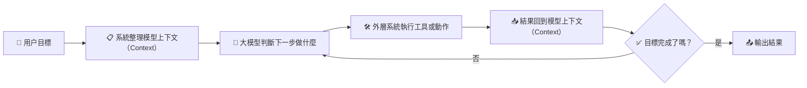

# 🤖 第四章 智能體是怎麼"幹活"的？

## 🤔 讀前先想

- 智能體（Agent）看起來會連續做事，它到底比聊天機器人多了什麼？
- 它明明還是大語言模型（Large Language Model，`LLM`），為什麼會讓人覺得像"自己在做事"？

## 🧭 章節定位

| 維度 | 內容 |
|:---|:---|
| 📍 橫向定位 | 這一章更偏向駕馭工程派（Harness Engineering），但會反覆説明它仍然建立在大語言模型（Large Language Model，`LLM`）之上。 |
| 🎯 本章回扣 | 1. 回到本質一：智能體（Agent）底層仍然是生成文字的概率模型。<br>2. 回到本質二：智能體（Agent）之所以看起來會連續做事，是因為外層系統在持續組織模型上下文（Context）、工具和多步循環。 |

---

## 🔄 總流程：一個最簡單的執行循環



> 💡 **核心邏輯**：智能體（Agent）不是"變聰明瞭"，而是外層系統幫它把"接話的依據"組織得更完整，讓它能一圈一圈地轉下去。

---

## 📖 第一小節：智能體不是什麼新鮮物種——模型加外圍系統

### ❓ 提問

- 第二章看了那麼多技術，為什麼到了智能體這個階段，AI 突然看起來會"自己做事"了？
- 這種"會自己做事"的感覺，是從模型本身變強了，還是從別的地方來的？

### 📝 術語

- **中文**：智能體
- **英文**：Agent
- **補充**：圍繞目標連續完成多步任務的 AI 應用形態

### 💬 一句話解釋

説白了，智能體就是"大模型 + 一堆配合它的外圍系統"，像是一個會接話的人，配上了一套能幹活的工作台。

### 🧐 你可以先這樣理解

很多人第一次用智能體產品時，會覺得"它好像真的會自己幹活"。

但別忘了第一章説的：**大模型本質上還是"接話"的概率模型**，它不會真的"規劃"，也不會"動手"。

那為什麼智能體看起來會連續做事？

答案是：**外圍系統幫它搭了一個"工作台"**——模型負責"判斷下一步説什麼"，系統負責"把話説完、把事做完、把結果記好"。

### 📊 智能體的基本架構

```
                          🎯 用户目標
                       "訂明天去上海的機票"
                             │
                             ▼
┌──────────────────────────────────────────────────────────┐
│                      智能體（Agent）                      │
│                                                          │
│   🎯 目標       🛠️ 工具説明      🧠 記憶      🔒 邊界   │
│  "訂機票"    "可查航班、下單"   "之前的操作"  "下單要確認" │
│      │              │               │             │      │
│      └──────────────┴───────┬───────┴─────────────┘      │
│                            ▼                             │
│  ┌────────────────────────────────────────────────────┐  │
│  │                📋 上下文（Context）                  │  │
│  │           "模型此刻能看到的所有信息"                  │  │
│  └──────────────────────┬─────────────────────────────┘  │
│            ▲            │                                │
│            │            ▼                                │
│            │   ┌─────────────────┐                       │
│            │   │     🧠 大模型    │                       │
│            │   │  "下一步該查航班" │                       │
│            │   └────────┬────────┘                       │
│            │            │                                │
│            │     ┌──────┴──────┐                         │
│            │     │             │                         │
│            │  需要工具      可以輸出                        │
│            │     │             │                         │
│            │     ▼             │                         │
│            │  ┌──────────┐     │                         │
│            │  │ 🛠️ 執行  │     │                         │
│            │  │ 調用工具  │     │                         │
│            │  └────┬─────┘     │                         │
│            │       │           │                         │
│            │       ▼           │                         │
│            │  ┌──────────┐     │                         │
│            │  │ 📥 結果  │     │                         │
│            │  │ 回寫上下文│     │                         │
│            │  └────┬─────┘     │                         │
│            │       │           │                         │
│            └───────┘           │                         │
│          繼續循環               ▼                         │
│                           📤 輸出結果                     │
│                        "已為您預訂航班"                    │
└──────────────────────────────────────────────────────────┘
```

> 💡 **關鍵理解**：模型只負責中間"判斷下一步"的環節，其他都是外圍系統在配合。外圍系統把目標、工具説明、歷史結果、約束條件全寫進上下文，模型基於上下文判斷，系統再執行、回寫，一圈一圈轉下去。

---

### 📖 示例：改代碼的場景

| | 普通聊天機器人 | 智能體形態 |
|:---|:---|:---|
| **你輸入** | "幫我改個 bug" | "幫我改個 bug" |
| **AI 做什麼** | 給你建議，不動手 | 讀取代碼 → 分析 → 修改 → 測試 → 再修改 |
| **本質區別** | 模型只"説話" | 模型"説話"+系統"做事" |

看起來是"自己會做事"，其實底層還是那個模型，只是外圍系統幫它把"做事的流程"串起來了。

### ✅ 你只需要記住

| 要點 | 説明 |
|:---|:---|
| 🤖 系統形態 | 智能體是"模型+外圍系統"的組合，不是新模型 |
| 🎯 分工明確 | 模型負責"判斷下一步説什麼"，系統負責"執行和記錄" |
| 🔄 循環推進 | 看起來"連續做事"，其實是"判斷→執行→再判斷"在轉 |

---

💭 **第1小節我們明白了**：智能體不是什麼新鮮物種，而是"大模型+外圍系統"的組合。那它到底是怎麼"一圈一圈轉下去"的？這就要説到執行循環。

## 📖 第二小節：執行循環——智能體的核心工作方式

### ❓ 提問

- 為什麼智能體不能"一口氣想完所有步驟再執行"，只能"做一步、看一步、再決定下一步"？
- 任務一長，為什麼就容易亂套或忘記前面做過什麼？

### 📝 術語

- **中文**：執行循環
- **英文**：Execution Loop
- **補充**："做一步，看結果，再決定下一步"的循環過程

### 💬 一句話解釋

説白了，大多數智能體（Agent）的核心，就是一個不斷轉的循環：判斷下一步 → 執行動作 → 看結果 → 再判斷。

### 🧐 你可以先這樣理解

為什麼需要循環？因為**模型一次只能生成一段文字**。

它沒法"一次性把整個任務想完再執行"。

### 📊 執行循環的運轉過程

```
第1圈：判斷 → 執行 → 看結果
   │
   ▼
第2圈：再判斷 → 再執行 → 再看結果
   │
   ▼
第3圈：繼續判斷...直到完成
```

每轉一圈，都要調一次模型，都要花錢。

### ⚠️ 循環拉長後的三個麻煩

| 問題 | 表現 | 例子 |
|:---|:---|:---|
| 💰 **成本** | 圈數多了費用上漲 | 一個複雜任務轉了20圈，賬單驚人 |
| 🔒 **權限** | 不知道該不該自動做 | 發郵件可以自動，轉賬需要確認 |
| 🎯 **跑偏** | 忘記最初要幹嘛 | 查着查着資料，偏離了原本的目標 |

---

### 📊 執行循環的各個環節

| 環節 | 系統做什麼 | 模型做什麼 |
| --- | --- | --- |
| 🎯 接到目標 | 接收用户輸入，明確任務 | — |
| 📋 整理上下文 | 把目標、工具説明、歷史結果組織好 | — |
| 🧠 判斷下一步 | — | 基於上下文，生成下一步動作 |
| 🛠️ 執行動作 | 真正調用工具、操作外部系統 | — |
| 📥 讀取結果 | 把執行結果格式化，放回上下文 | — |
| ✅ 判斷結束 | 檢查目標是否完成 | 判斷"該繼續還是該停" |

### ✅ 你只需要記住

- 🔄 智能體（Agent）最重要的不是"會不會説"，而是"能不能圍繞目標穩定地轉完這個循環"
- ⚠️ 循環一拉長，成本、權限、跑偏風險都會上來
- 📋 關鍵還是上下文：給得越清楚，循環轉得越穩

---

💭 **第2小節我們明白了**：智能體之所以能"一圈一圈轉下去"，靠的是執行循環。但循環要轉得穩，需要哪些條件？這就得拆解它的核心部件。

## 📖 第三小節：目標與上下文——智能體的方向盤和視野

### ❓ 提問

- 為什麼目標説不清楚，智能體就容易跑偏？
- 上下文到底要裝什麼信息，才能讓智能體判斷得準？

---

### 📝 術語

| 項目 | 內容 |
|:---|:---|
| **目標** | 智能體要完成什麼任務、做到什麼程度算完成 |
| **上下文** | 智能體當前能看到的全部信息，包括目標、歷史記錄、工具説明等 |

---

### 💬 一句話解釋

> 💡 目標告訴智能體"要去哪"，上下文告訴它"現在在哪、能看到什麼"。

---

### 🧐 你可以先這樣理解

想象你在開車：
- **目標**就是導航的目的地——沒有它，你根本不知道往哪開
- **上下文**就是你眼前能看到的——路況、路標、後視鏡裏的景象

智能體也一樣。目標不清楚，它不知道做到什麼程度算完；上下文給得不對，它會基於錯誤信息做判斷。

### 🎯 目標與上下文的作用

```
        🎯 目標（方向盤）          📋 上下文（視野）
           │                          │
           ▼                          ▼
    ┌─────────────┐            ┌─────────────┐
    │ "要去哪"    │            │ "現在在哪"   │
    │ "做到什麼   │            │ "前面做了啥" │
    │  程度算完"  │            │ "能看到啥"   │
    └──────┬──────┘            └──────┬──────┘
           │                          │
           └──────────┬───────────────┘
                      │
                      ▼
               ┌─────────────┐
               │  模型判斷    │
               │ "下一步     │
               │  該做什麼"  │
               └─────────────┘
```

### 📊 目標清晰 vs 模糊

| 模糊目標 ❌ | 清晰目標 ✅ |
|:---|:---|
| "幫我整理資料" | "整理5份行業報告，提取關鍵觀點，做成對比表格" |
| 結果：不知道要整理什麼、整理到什麼程度 | 結果：知道範圍、知道格式、知道什麼時候算完成 |

### ⚠️ 上下文出問題的典型場景

| 表面現象 | 根因 | 上下文裏缺了啥 |
|:---|:---|:---|
| "能讀文件卻讀錯目錄" | 上下文沒給對 | 正確的文件路徑 |
| "轉着轉着忘了要幹嘛" | 目標被沖淡 | 原始目標被後來的內容淹沒了 |

---

### ✅ 你只需要記住

| 要點 | 説明 |
|:---|:---|
| 🎯 **目標是方向盤** | 目標越清楚，智能體越知道做到什麼程度算完成 |
| 📋 **上下文是視野** | 上下文給得越對，智能體判斷越準 |
| ⚠️ **常見問題** | 目標模糊會跑偏，上下文錯誤會誤判 |

---

## 📖 第四小節：工具與邊界——讓 AI 既能幹活又不闖禍

### ❓ 提問

> AI看起來能調用各種工具，但它是真的"會用了"，還是只是在"碰運氣"？  
> 如果AI調錯了工具、傳錯了參數，或者停不下來，該怎麼辦？

### 📝 術語

- **工具（Tool）**：AI能調用的外部能力，比如搜索、發郵件、改文件
- **邊界（Boundary）**：對AI行為的約束，告訴它什麼能做、什麼不能做、做到什麼程度算完

### 💬 一句話解釋

> 工具是AI的"手腳"，讓它能真的動手做事；邊界是"圍欄"，防止它闖禍或失控。

### 🧐 你可以先這樣理解

前兩節講了目標和上下文——這是AI的"腦子"裏的東西。但AI要真的幫你幹活，還得有"手腳"——**工具**。

想象你指揮一個機器人：
- 你説"幫我把這份文檔發給客户"——這是目標
- 機器人需要"會發郵件"——這是工具
- 但如果機器人沒搞清楚發給誰、發什麼內容，就可能發錯——這是工具説明不清楚的問題
- 如果機器人發完郵件還要自動轉賬，你肯定不放心——這是缺少邊界的問題

**工具讓AI能幹活，邊界讓AI幹對活、不闖禍**。

### 📚 工具是怎麼被調用的

AI調用工具，不是"親手去點按鈕"，而是**"發號施令"**。

系統先把工具的説明書放進上下文：
```
工具名：發郵件
參數：
  - 收件人（必填）：郵箱地址
  - 主題（必填）：郵件標題
  - 內容（必填）：郵件正文
```

模型看完説明書，輸出"我要調用發郵件工具，參數是..."，然後外圍系統真正去執行。

**⚠️ 這裏容易出問題：説明書不清楚**

| 説明書不清晰 ❌ | 結果 |
|:---|:---|
| "日期參數傳日期" | 模型傳"2024-01-01"，但工具要時間戳格式 |
| "選最合適的選項" | 模型和用户理解的"合適"不一樣 |

| 説明書清晰 ✅ | 結果 |
|:---|:---|
| "日期參數傳Unix時間戳（如1704067200）" | 模型傳對的格式 |
| "選價格最低的選項" | 標準明確，不容易歧義 |

### 📚 為什麼需要邊界

工具有了，但如果不加約束，AI可能會：

| 問題 | 場景 | 後果 |
|:---|:---|:---|
| 💰 **花錢沒節制** | 查資料時循環了50次 | 賬單爆炸 |
| 🔐 **做錯事** | 自動發了郵件給錯誤的人 | 造成實際損失 |
| ⏹️ **停不下來** | 一直在"優化"，不知道啥時候算完 | 無限循環 |

**三類基本邊界**：

| 邊界 | 管什麼 | 例子 |
|:---|:---|:---|
| 💰 **成本邊界** | 最多調幾次模型、花多少錢 | "最多循環10次" |
| 🔐 **安全邊界** | 哪些操作要停下來問你 | "發郵件前給我確認" |
| ⏹️ **終止邊界** | 什麼時候算完成任務 | "找到答案就停" |

> 💡 **補充：CLI——讓AI真動手的工作環境**
> 
> 當AI需要直接改你的文件、執行命令時，單純在聊天窗口"給建議"就不夠用了。這時候需要CLI（命令行界面）——一個讓AI能真動手、你又能看得見的環境。
> 
> CLI的特點：
> - AI直接改文件，不是隻告訴你"應該改哪裏"
> - 改完後生成diff（對比圖），讓你看改了什麼
> - 你説不對，AI馬上調整，連續迭代
> 
> CLI不是必須學的技術，而是一種讓AI從"顧問"變成"搭檔"的工作方式。

### ✅ 你只需要記住

1. **工具是説明書遊戲**：工具説明寫清楚，AI才能調對；寫模糊，就會出問題
2. **邊界是保險機制**：不是不信任AI，而是防止意外——概率模型本來就會犯錯
3. **CLI是深度協作**：需要AI真動手改文件時，CLI比聊天窗口更直接、更可控

---

## 📖 第五小節：觀測與循環——智能體的眼睛和心跳

### ❓ 提問

- AI調用了工具，它怎麼知道工具執行的結果？
- 為什麼智能體不能"一口氣想完所有步驟再執行"，只能"做一步、看一步、再決定下一步"？

---

### 📝 術語

| 項目 | 內容 |
|:---|:---|
| **觀測（Observation）** | 智能體獲取工具執行結果和環境反饋的機制 |
| **循環（Loop）** | 智能體持續運轉的迭代架構：判斷→執行→觀測→再判斷 |

---

### 💬 一句話解釋

> 💡 **觀測是智能體的"眼睛"——讓它知道工具執行的結果；循環是智能體的"心跳"——讓它能一圈一圈持續運轉。**

---

### 🧐 你可以先這樣理解

#### 觀測：為什麼必不可少？

想象你讓助手去查天氣，助手打了電話諮詢，但**不告訴你結果**。這樣有用嗎？沒用。

智能體也一樣。它調用工具後，必須**觀測**工具返回的結果，才能決定下一步做什麼。

```
調用工具 ──► 等待執行 ──► 觀測結果 ──► 基於結果再判斷
                │              │
                ▼              ▼
           "查到了天氣"   "明天晴天，25度"
```

**觀測的關鍵作用**：
- 告訴智能體"工具到底做了什麼"
- 提供真實數據，防止模型"瞎猜"
- 為下一輪判斷提供依據

#### 循環：為什麼不能"一口氣做完"？

模型一次只能生成一段文字，沒法"一口氣想完所有步驟再執行"。所以智能體只能一圈一圈地轉：

```
第1圈：判斷下一步 → 執行 → 觀測結果 → 再判斷
   │
   ▼
第2圈：判斷下一步 → 執行 → 觀測結果 → 再判斷
   │
   ▼
直到完成
```

這就像走路：你每走一步，都要看看腳下，再決定下一步往哪走。不可能站在起點就把整條路都"看"完。

---

### 📊 觀測 vs 工具：有什麼區別？

| | 工具（Tool） | 觀測（Observation） |
|:---|:---|:---|
| **比喻** | 手——用來做事 | 眼睛——用來看結果 |
| **做什麼** | 真正執行操作（查天氣、發郵件） | 獲取執行後的反饋 |
| **方向** | 向外——作用於環境 | 向內——反饋給智能體 |
| **例子** | "調用天氣API" | "API返回：明天晴，25℃" |

> 💡 **關鍵理解**：工具是"輸出"，觀測是"輸入"。兩者配合，才能完成"行動→反饋→再行動"的閉環。

---

### 📊 循環的成本與控制

每轉一圈都要調用模型，都要花錢：

```
第1圈：調模型 ──► 花錢
   │
第2圈：調模型 ──► 再花錢
   │
第3圈：調模型 ──► 繼續花錢...
```

| 問題 | 關鍵挑戰 |
|:---|:---|
| ⚡ **效率** | 怎麼減少不必要的循環？ |
| 🎯 **穩定** | 怎麼確保每圈都朝着目標？ |
| 💰 **成本** | 循環次數上限設多少合適？ |

---

### ✅ 你只需要記住

| 要點 | 説明 |
|:---|:---|
| 👁️ **觀測是眼睛** | 讓智能體知道工具執行的結果，為下一步判斷提供依據 |
| 🔄 **循環是心跳** | 模型一次只能判斷一步，執行完觀測結果，再判斷下一步 |
| 💰 **循環有成本** | 圈數多了費用上漲，需要通過邊界來控制 |

---

## 📖 第六小節：記憶——多步任務的"承接"

### ❓ 提問

- 任務一長，為什麼就容易忘記前面做過什麼？
- 智能體是怎麼"記住"之前的對話和操作的？

---

### 📝 術語

| 項目 | 內容 |
|:---|:---|
| **記憶（Memory）** | 智能體在多步任務中保存和調用歷史信息的能力 |
| **長期記憶** | 跨會話保存的用户偏好、歷史任務等 |
| **短期記憶** | 當前任務中的上下文信息 |

---

### 💬 一句話解釋

> 💡 **記憶是智能體的"承接"——讓多步任務能連成線，而不是每步都重新開始。**

---

### 🧐 你可以先這樣理解

模型一次只能處理有限的上下文，如果任務太長，前面的信息容易丟失。這就需要**記憶**來承接——把關鍵信息保存下來，讓下一步能基於完整的歷史做判斷。

```
第1步 ──► 記住結果 ──► 第2步 ──► 記住結果 ──► 第3步
          │                     │
          └─────── 上下文 ──────┘
```

**沒有記憶會怎樣？**

| 步驟 | 該記住的 | 實際 |
|:---|:---|:---|
| 第1步查資料 | 查到了A、B、C | ✅ 記住了 |
| 第2步整理 | 要基於A、B、C整理 | ❌ 忘了A、B、C是啥 |
| 第3步輸出 | 輸出整理結果 | ❌ 完全斷了線，重新開始 |

---

### ✅ 你只需要記住

| 要點 | 説明 |
|:---|:---|
| 🧠 **記憶是承接** | 多步任務需要記憶把歷史信息傳給下一步 |
| 📋 **記憶靠上下文** | 短期記憶就是上下文裏保存的歷史記錄 |
| 💾 **長期記憶存偏好** | 跨會話的記憶需要專門存儲（如數據庫、文件） |

---

## 📖 第七小節：舉個例子串起來——看所有部件怎麼協作

### 場景：讓智能體幫你準備明天的演講

**目標**（🎯）：
> "幫我準備明天的部門分享：主題是 AI 在辦公場景的應用，需要一份 5 分鐘的發言稿和配套 PPT 大綱"

**執行過程**：

| 循環 | 上下文裏有什麼 | 模型判斷 | 執行動作 | 觀測結果 |
| --- | --- | --- | --- | --- |
| 第1圈 | 目標 + 工具説明 | "需要先查一些資料" | 調用搜索工具 | 返回10篇相關文章 |
| 第2圈 | 目標 + 搜索結果 | "資料夠了，開始整理大綱" | 整理 PPT 大綱 | 大綱完成 |
| 第3圈 | 目標 + 大綱 | "現在寫發言稿" | 寫發言稿 | 發言稿完成 |
| 第4圈 | 目標 + 大綱 + 發言稿 | "檢查是否完整" | 自檢完成 | 任務完成 |

**關鍵部件協作**：
- 🎯 **目標**：始終保存在上下文裏，防止跑偏
- 📋 **上下文**：每圈都包含歷史結果
- 🛠️ **工具**：搜索、整理、寫作
- 👁️ **觀測**：獲取每步執行的結果
- 🔄 **循環**：一圈一圈推進任務
- 🔒 **邊界**：每圈都檢查成本和時間
- 🧠 **記憶**：大綱和發言稿一直保留在上下文裏
- 🧠 **核心大腦**：基於上下文做判斷

---

### 📖 反面案例：如果某個部件掉鏈子

為了理解每個部件的重要性，我們來看看**如果某個部件出問題**，會發生什麼：

| 出問題的部件 | 場景表現 | 根因分析 | 後果 |
|:---|:---|:---|:---|
| 🧠 **核心大腦** | 明明給對了信息，判斷卻總是離譜 | 模型能力不足或選型不當 | 整體可靠性下降，即使其他部件再好也沒用 |
| 🎯 **目標** | 智能體東拉西扯，不知道做到什麼程度算完成 | 目標不清晰或沒有被持續強調 | 偏離最初方向，產出與預期不符 |
| 📋 **上下文** | 能讀文件卻讀錯目錄；引用了錯誤的資料 | 上下文組織錯誤，信息沒給對 | 基於錯誤信息做判斷，一步錯步步錯 |
| 🛠️ **工具** | 調用工具時參數格式錯誤；該調A卻調了B | 工具説明不清楚，或模型理解有誤 | 執行失敗，需要人工介入修復 |
| 🔒 **邊界** | 自動發了郵件給錯誤的人；修改了不該改的文件 | 權限控制缺失，邊界太鬆 | 造成實際損失，難以挽回 |
| 👁️ **觀測** | 調用了工具卻不知道結果；基於錯誤的結果做下一步判斷 | 觀測機制缺失或結果解析錯誤 | 行動盲目，可能基於錯誤信息繼續執行 |
| 🔄 **循環** | 轉了20圈還沒完成，賬單爆炸；或者早早結束，任務根本沒做完 | 終止邊界沒設好，或目標檢查失效 | 成本失控，或任務失敗 |
| 🧠 **記憶** | 第3步忘了第1步查到的資料；每次對話都像第一次 | 記憶沒有有效保存或繼承 | 無法完成多步驟任務，體驗割裂 |

**核心洞察**：

> **智能體的可靠程度 = 八個部件中最薄弱的那個環節。**

就像一個木桶能裝多少水，取決於最短的那塊板。

> 設計智能體時，不能只關注某個部件做得多好，而要確保**每個部件都達到基本可靠的水平**。

---

### 📖 八部件的關聯：為什麼缺了誰都不行

八個部件不是獨立的，而是**相互依賴、環環相扣**：

```
🧠 核心大腦 ───────────────────────────────┐
🎯 目標 ──────┐                            │
📋 上下文 ←───┼── 目標決定上下文要裝什麼      │
🛠️ 工具 ──────┼── 工具説明要放進上下文        │
🔒 邊界 ──────┼── 邊界約束也要寫進上下文      │
🧠 記憶 ──────┘                            │
      │                                    │
      ▼                                    │
   上下文組織（本質二的核心）                │
      │                                    │
      ▼                                    │
🧠 大模型判斷（本質一：概率接話）◄───────────┘
      │
      ▼
🛠️ 工具執行
      │
      ▼
👁️ 觀測結果 ──→ 結果回寫上下文 → 記憶保存
      │
      ▼
🔄 循環判斷：繼續？還是完成？
```

**關鍵規律**：
- 所有部件的信息，最終都要通過**上下文**傳遞給模型
- 模型的判斷質量，取決於**上下文的質量**
- **觀測**提供真實反饋，防止模型"瞎猜"
- **循環**讓任務能持續推進，直到完成
- 多步任務的連貫性，取決於**記憶的承接**

---

> **智能體的設計，本質上就是八部件的協同設計。**

---

## 📝 本章要義

> 💡 **一句話核心結論**：智能體（Agent）不是突然出現的"新物種"，而是把之前學到的所有要素——**模型能力、工具調用、上下文管理、觀測反饋、執行循環、記憶系統**——整合在一起的自然產物。

---

### 🔗 核心脈絡回顧

| 小節 | 關鍵認知 | 遞進關係 |
| :--- | :--- | :--- |
| 📖 第1節 | 智能體是"模型+系統"的組合，不是新物種 | 回答了"是什麼" |
| 📖 第2節 | 執行循環："判斷→執行→看結果→再判斷"的循環機制 | 回答了"怎麼轉起來" |
| 📖 第3節 | 目標與上下文：方向盤和視野，決定往哪走、能看到什麼 | 拆解第一個核心部件 |
| 📖 第4節 | 工具與邊界：手腳和圍欄，決定能做什麼、什麼不能做 | 拆解第二個核心部件 |
| 📖 第5節 | 執行循環與記憶：心跳和承接，決定能否持續穩定推進 | 拆解第三個核心部件 |
| 📖 第6節 | 綜合示例：所有部件如何協作完成一個真實任務 | 串起來看整體 |

---

### 🎯 回到兩個本質

| 本質 | 核心理解 |
| :--- | :--- |
| 🎯 **本質一（概率模型）** | 智能體底層仍然是那個"接話"的概率模型。它不會真的"思考"或"計劃"，只是在更豐富的上下文裏判斷"下一步該説什麼"。 |
| 📋 **本質二（上下文）** | 智能體之所以能"連續做事"，是因為外層系統把目標、工具説明、歷史結果、約束條件等更多信息，持續地組織進上下文。上下文範圍越大、越清晰，智能體表現得越"聰明"。 |

---

### 🧩 智能體是自然演進的綜合產物

回顧前幾章的內容，智能體的出現不是偶然：

| 演進階段 | 學到什麼 | 在智能體中的作用 |
| :--- | :--- | :--- |
| 💬 ChatGPT 時刻 | 模型只能"接話" | 底層基礎，始終不變 |
| 🔍 RAG | 上下文可以擴展 | 智能體需要持續補充信息 |
| 🛠️ 工具調用 | 模型可以"發號施令" | 智能體真正"動手"的能力 |
| 📋 工作流 | 流程可以組織 | 智能體需要穩定的執行框架 |
| 🧠 記憶系統 | 歷史可以保留 | 多步任務需要承接上下文 |

**智能體 = 模型能力 + 工具調用 + 上下文管理 + 執行循環 + 記憶系統 + 邊界約束**

它不是某個單一技術的突破，而是所有這些要素發展到一定階段後，**自然而然整合出來的形態**。

---

### 📖 自己動手：拆解一個智能體任務

**實驗任務**：觀察一個智能體任務的完整執行過程

**步驟**：
1. 找一個你常用的智能體產品（如 ChatGPT、Claude、通義千問、豆包、DeepSeek、Kimi 等）
2. 給它一個多步驟任務，比如：
   ```
   幫我查一下最近一週 AI 領域的重要新聞，整理成一份簡報，然後給我三個值得深入關注的方向。
   ```
3. 觀察並記錄：
   - 它轉了幾圈？（執行循環）
   - 每圈在做什麼？（工具調用）
   - 有沒有停下來問你？（邊界控制）
   - 最後結果完整嗎？（目標達成）

**分析框架**：

| 部件 | 觀察點 | 這個產品的表現 |
| :--- | :--- | :--- |
| 🎯 目標 | 任務最終完成了嗎？ | |
| 📋 上下文 | 它似乎"知道"之前做了什麼嗎？ | |
| 🛠️ 工具 | 調用了哪些工具？成功了嗎？ | |
| 🔒 邊界 | 什麼時候停下來問你？ | |
| 🔄 循環 | 轉了幾圈？感覺快還是慢？ | |
| 🧠 記憶 | 換了個話題後，它還記得這個任務嗎？ | |

**思考問題**：
- 哪個部件表現得最好？
- 哪個部件似乎有問題？
- 如果讓你改進這個產品，你會優化哪個部件？

**進階挑戰**：
試着讓同一個任務失敗（比如給模糊的目標、或故意干擾上下文），觀察哪個部件最先出問題。

---

### 🌉 為下一章鋪墊

明白了智能體是怎麼工作的，下一個問題自然來了：

市面上有那麼多智能體產品——OpenAI 的、Claude 的、各種開源的、企業自己搭的...**它們表面名字不同，但底層部件的組合方式，才是決定體驗差距的關鍵**。

更重要的是：**同樣的八部件，不同的產品選擇了不同的組裝方式**——有的偏重上下文記憶，有的偏重邊界控制，有的追求循環速度，有的追求執行穩定。

怎麼把這些產品放到同一張圖裏對比？不同的組裝方式帶來什麼差異？

這就是第五章要聊的：**萬變不離其宗——拆開 OpenClaw 和 Claude Code 看本質**——用八部件框架，拆解兩個看似完全不同的產品。
